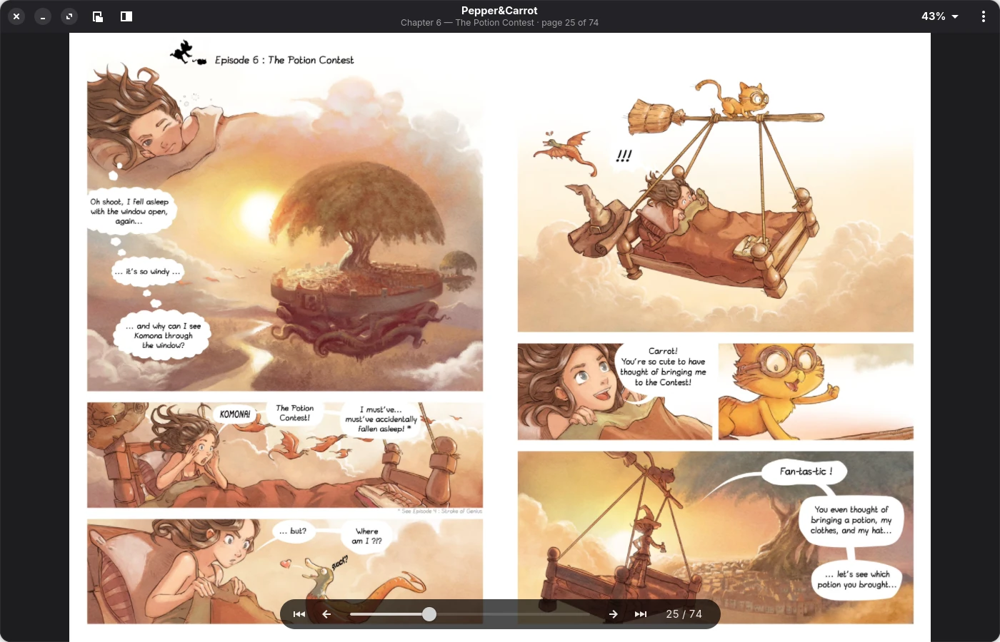
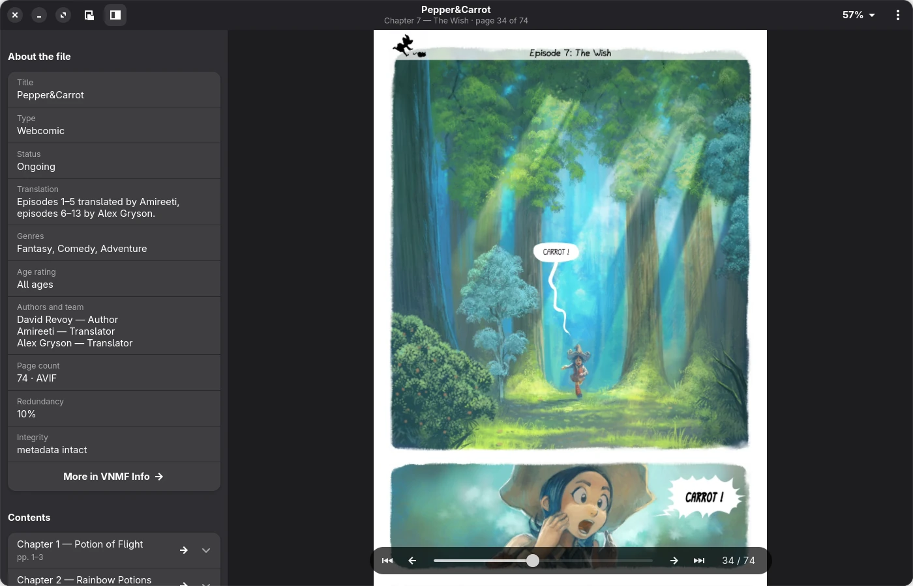
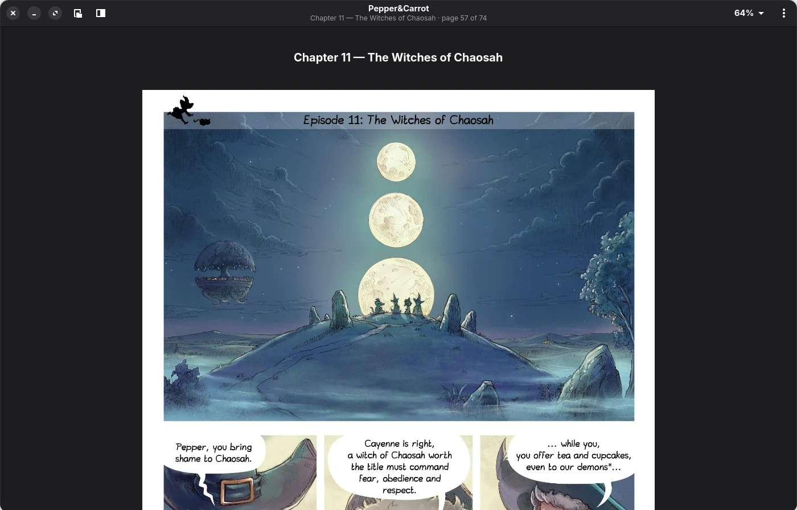
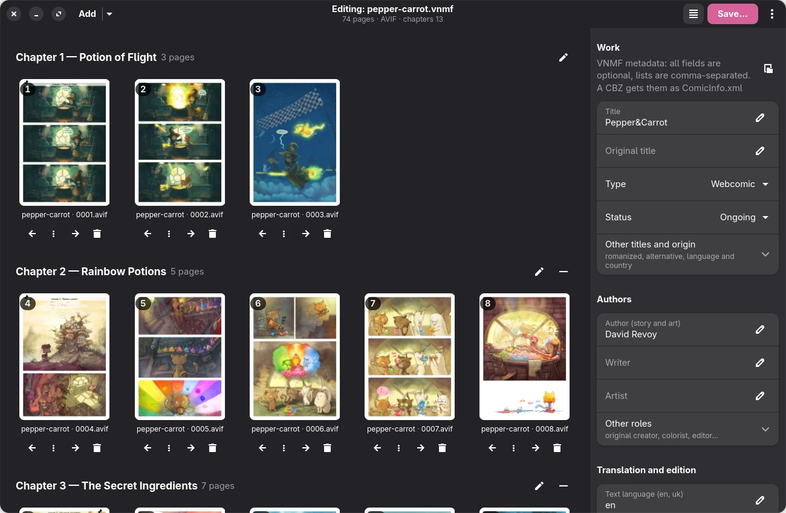
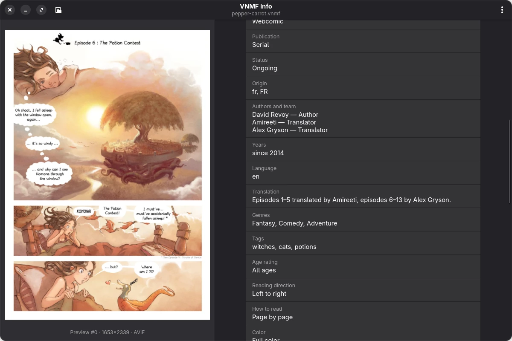
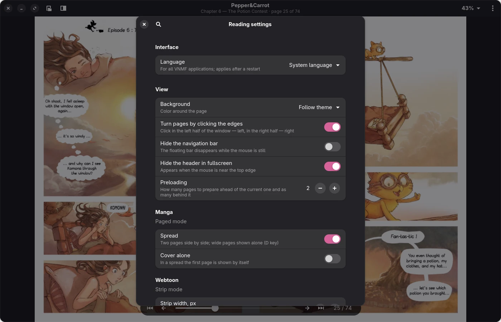
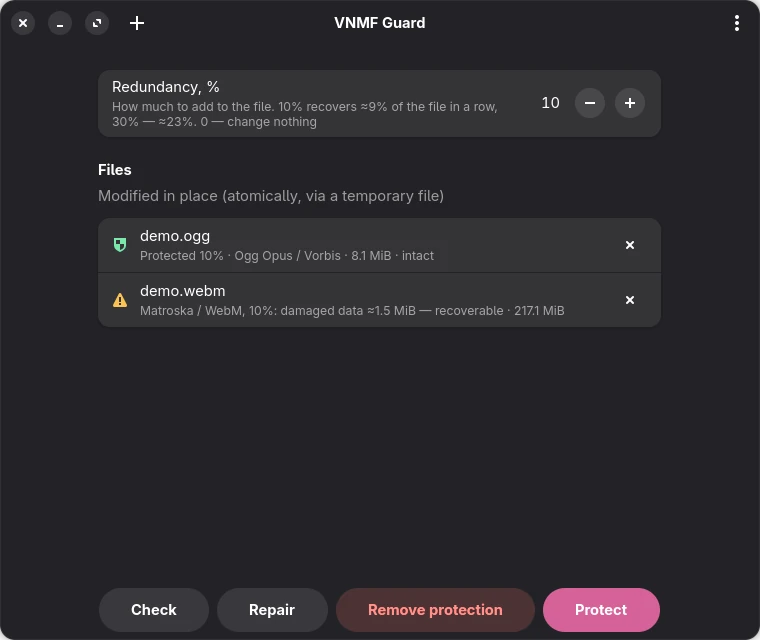

# VNMF

**VNMF** is an open container format for manga, comics and webtoons, together with a set of tools
to create, read, inspect and repair such files.

A `.vnmf` file holds page images, cover previews, volume and chapter structure, rich metadata and
optional page attachments (music, sound effects, text, dark versions of pages). It is designed to
survive storage faults: every structure is checksummed, the metadata is duplicated at the end of
the file, and optional Reed–Solomon redundancy can restore damaged regions.

VNMF is developed first and foremost for the author's own manga library, so its features and
priorities follow that use. Still, it's free software: anyone is welcome to try it, use it for
their own collection, report problems or suggest improvements.

> **Status: beta (0.1.0-beta).** The file format itself is at version 2.0 and its layout is
> fixed, but the tools are young and have only been tested by the author. Keep your originals.



## Features

- **Any image format, detected by contents:** AVIF, JPEG, PNG, WebP, GIF, JPEG XL — mixed formats
  are allowed even within one webtoon episode.
- **Manga and webtoons:** pages and spreads with right-to-left reading, or long strips made of
  fragments.
- **Structure:** volumes and chapters, fractional chapter numbers ("10.5"), per-volume covers,
  page roles (cover, spread halves, credits…).
- **Metadata:** its own JSON schema (`vnmf-metadata/1`) covering manga, manhwa, manhua, western
  comics and translations; lossless conversion from and to `ComicInfo.xml`.
- **Page attachments:** background music, sound effects, a text layer and dark-theme versions of
  pages.
- **Damage resistance:** CRC32 on every structure and data chunk, a tail copy of all metadata,
  optional Reed–Solomon parity (up to 30 %, recovers a contiguous damaged region of roughly the
  same size), and carving of images by signature when everything else is lost.
- **Zero-copy reading:** all structures are naturally aligned and can be memory-mapped directly.

The format is specified at byte level in [FORMAT.md](FORMAT.md) — enough to write a compatible
reader or writer without this code.

## Applications

| | |
|---|---|
| **VNMF Reader** | reader for manga (pages, spreads, right to left) and webtoons (continuous strip); zoom, table of contents, remembered reading position, page music and sound, text panel, dark pages |
| **VNMF Creator** | builds and edits `.vnmf` files from images, folders, CBZ or other `.vnmf` files: reordering by drag and drop, volumes and chapters, page roles, covers, metadata, attachments, redundancy |
| **VNMF Info** | full file information with a cover and page viewer and a background integrity check |
| **VNMF Guard** | adds the same kind of Reed–Solomon protection to ordinary media files (MKV, WebM, MP4, FLAC, Ogg/Opus, MP3, zstd, gzip, ISO) without breaking them for other programs |
| **Thumbnailer** | `.vnmf` thumbnails in file managers |
| **Android reader** | a reader for Android 12+ built on the same Rust core (`android/`) |

The desktop applications use GTK 4 and libadwaita and are available in English and Ukrainian
(see [Translations](#translations)).

### Screenshots

| | |
|---|---|
|  |  |
| Reader: file information and table of contents | Reader: continuous strip mode |
|  |  |
| Creator: chapters, pages and metadata | Info: cover, metadata and integrity |
|  |  |
| Reader settings, including the interface language | Guard: one file intact, the other damaged and recoverable |

The comic in the screenshots is [Pepper&Carrot](https://www.peppercarrot.com) by David Revoy,
episodes 1–13 (English translation by Amireeti and Alex Gryson), licensed under
[CC BY 4.0](https://creativecommons.org/licenses/by/4.0/). The pages were converted to AVIF and
packed into a `.vnmf` file with `vnmfpack`; the comic itself is not part of this repository.

### Console tools

| Tool | Purpose |
|---|---|
| `vnmfpack` | create `.vnmf` from CBZ, folders or images |
| `vnmfunpack` | unpack into a folder or CBZ (with `vnmf.json` and `ComicInfo.xml`) |
| `vnmfinfo` | file information and integrity check |
| `vnmfrecovery` | repair a damaged file or extract what survived |
| `vnmfguard` | protect / check / repair / strip media files |
| `vnmfbadtest` | deliberately corrupt a file to test recovery |

```sh
vnmfpack ch1.cbz ch2.cbz ch3/ -o volume1.vnmf --cover first
vnmfpack series/ -o series.vnmf --redundancy 10     # series/Volume 1/Chapter 1/*.png
vnmfpack scans/*.png --webtoon -o episode.vnmf
vnmfinfo volume1.vnmf
vnmfunpack volume1.vnmf -o volume1.cbz
vnmfrecovery damaged.vnmf                           # → damaged.repaired.vnmf
vnmfguard protect -r 10 movie.mkv
```

Every tool has `--help` with examples.

## Building

Requirements: Rust 1.88 or newer, GTK ≥ 4.22, libadwaita ≥ 1.8, and gettext for translations.
On Fedora:

```sh
sudo dnf install cargo rust gtk4-devel libadwaita-devel gettext
cargo build --release
cargo test --workspace
```

### Installing (Linux)

```sh
sudo ./install.sh --system    # /usr/local, for all users, with file manager thumbnails (recommended)
./install.sh                  # ~/.local, no sudo; thumbnails won't work in GNOME
./install.sh --uninstall      # remove (with the same options)
```

The installer registers the `application/x-vnmf` file type, application launchers, icons, the
thumbnailer and the translations, and makes VNMF Reader the default application for `.vnmf`.

An RPM for Fedora can be built with `packaging/make-srpm.sh --rpm` (requires `rpm-build`).

### Android

Requirements: Android Studio (or the Android SDK), [`cargo-ndk`](https://github.com/bbqsrc/cargo-ndk)
and the Rust targets for the device:

```sh
cargo install cargo-ndk
rustup target add aarch64-linux-android x86_64-linux-android
```

Open the `android/` folder in Android Studio and build; Gradle compiles the Rust library
(`vnmf-ffi`) and generates the Kotlin bindings itself.

## Project layout

| Crate / folder | What it is |
|---|---|
| `vnmf-core` | the format: binary structures, builder, reader, recovery |
| `vnmf-parity` | Reed–Solomon redundancy; usable on its own for any block-aligned data |
| `vnmf` (root) | shared code of the tools (CBZ/folder input, metadata, ComicInfo) and the console tools |
| `vnmf-guard` | parity inside ordinary media files |
| `vnmf-gui` | the GTK applications |
| `vnmf-i18n` | runtime translations (gettext) |
| `vnmf-ffi` | UniFFI bindings for Android |
| `android/` | the Android reader (Kotlin, Jetpack Compose) |
| `data/`, `packaging/`, `po/` | desktop integration, RPM spec, translations |

## Translations

The desktop applications use gettext catalogs in [`po/`](po/). A new language only needs a new
`.po` file — the programs don't have to be rebuilt. See [po/README.md](po/README.md).

The Android reader uses standard Android string resources: English in
`android/app/src/main/res/values/strings.xml`, Ukrainian in `values-uk/`. It follows the phone's
language, and on Android 13+ the language can also be chosen per app in the system settings.
A new language is a `values-<lang>/strings.xml` file plus an entry in `res/xml/locales_config.xml`.

## Contributing

Bug reports, fixes, translations and ideas are welcome — see [CONTRIBUTING.md](CONTRIBUTING.md).

## About the development

VNMF is designed and maintained by void_nicole (Nicole Hitori). A large part of the code and
documentation was written with the help of an AI assistant (Claude by Anthropic) under the
author's direction and review.

## License

The specification, the libraries, the console tools and the applications are free software,
licensed under the **GNU General Public License, version 3 or later** (`GPL-3.0-or-later`).
See [LICENSE](LICENSE).
